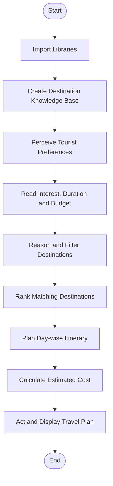

# EX-NO-9: Building a Simple AI Agent – AI Tourist Guide for India

## AIM

To design, implement, and test a simple goal-based AI agent in Python that plans a personalised India trip itinerary for a tourist based on their interests, trip duration, and daily budget.

---

## INTRODUCTION

An AI agent is a system that perceives its environment through sensors and performs actions through actuators to achieve a specific goal.

AI agents can be classified into different types:

1. **Simple Reflex Agent:** Selects actions based only on the current input.
2. **Goal-Based Agent:** Selects actions that help achieve a predefined goal.
3. **Utility-Based Agent:** Selects actions that maximise a measure of usefulness or satisfaction.

A useful way to describe an AI agent is through the **PEAS framework**:

- **P – Performance Measure:** Measures how successfully the agent achieves its goal.
- **E – Environment:** The surroundings in which the agent operates.
- **A – Actuators:** The mechanisms through which the agent performs actions.
- **S – Sensors:** The mechanisms through which the agent receives information.

In this experiment, an **AI Tourist Agent for India** is developed as a goal-based agent. It receives a tourist's preferences, searches a predefined knowledge base of Indian destinations, prepares a day-wise itinerary, and presents a personalised travel recommendation within the given budget.

---

## PEAS FRAMEWORK

| Component | Description |
|---|---|
| Performance Measure | Personalised itinerary, budget compatibility, and trip duration |
| Environment | Knowledge base containing Indian tourist destinations |
| Actuators | Displaying recommended destinations and travel itinerary |
| Sensors | Receiving tourist interests, trip duration, and daily budget |

---

## WORKFLOW DIAGRAM

The following diagram illustrates the working process of the AI Tourist Agent.



---

## PROCEDURE

### Step 1: Import Required Libraries

The `textwrap` library is imported to neatly format long destination descriptions while displaying the itinerary.

**Code:**

```python
import textwrap
```


### Step 2: Define the Agent's Knowledge Base (Destination Database)

The agent's knowledge base is stored as a Python list of dictionaries.

Each destination contains the following information:

- **Name:** Name of the Indian tourist destination.
- **Category:** Type of destination, such as heritage, spiritual, beach, hill station, adventure, nature, or wildlife.
- **Cost per Day:** Estimated daily travel cost.
- **Best Season:** Recommended season to visit.
- **Description:** Short description of the destination.

The knowledge base acts as the environment model that the agent uses to select suitable destinations.

**Code:**

```python
destinations = [
    {
        "name": "Taj Mahal, Agra",
        "category": "heritage",
        "cost": 2000,
        "season": "October to March",
        "description": "Explore the magnificent Taj Mahal, one of the Seven Wonders of the World."
    },
    {
        "name": "Jaipur, Rajasthan",
        "category": "heritage",
        "cost": 2500,
        "season": "October to March",
        "description": "Discover royal palaces, forts, traditional markets, and Rajasthani culture."
    },
    {
        "name": "Varanasi, Uttar Pradesh",
        "category": "spiritual",
        "cost": 1800,
        "season": "October to March",
        "description": "Experience ancient temples, spiritual traditions, and the Ganga riverfront."
    },
    {
        "name": "Goa",
        "category": "beach",
        "cost": 4000,
        "season": "November to February",
        "description": "Enjoy beautiful beaches, water activities, and vibrant coastal culture."
    },
    {
        "name": "Andaman Islands",
        "category": "beach",
        "cost": 5000,
        "season": "October to May",
        "description": "Explore clear waters, coral reefs, and beautiful tropical islands."
    },
    {
        "name": "Manali, Himachal Pradesh",
        "category": "hill_station",
        "cost": 3500,
        "season": "March to June",
        "description": "Enjoy mountain scenery, pleasant weather, and beautiful valleys."
    },
    {
        "name": "Coorg, Karnataka",
        "category": "adventure",
        "cost": 3000,
        "season": "October to March",
        "description": "Experience trekking, coffee plantations, waterfalls, and nature trails."
    },
    {
        "name": "Spiti Valley, Himachal Pradesh",
        "category": "adventure",
        "cost": 4500,
        "season": "May to October",
        "description": "Explore high-altitude landscapes, mountain roads, and adventure activities."
    },
    {
        "name": "Munnar, Kerala",
        "category": "nature",
        "cost": 2800,
        "season": "September to March",
        "description": "Visit green tea plantations, misty hills, and beautiful natural landscapes."
    },
    {
        "name": "Ranthambore, Rajasthan",
        "category": "wildlife",
        "cost": 4000,
        "season": "October to April",
        "description": "Explore wildlife habitats and enjoy guided tiger safari experiences."
    }
]
```

### Destination Knowledge Base Summary

| Destination | Category | Estimated Cost/Day |
|---|---|---:|
| Taj Mahal, Agra | Heritage | ₹2,000 |
| Jaipur | Heritage | ₹2,500 |
| Varanasi | Spiritual | ₹1,800 |
| Goa | Beach | ₹4,000 |
| Andaman Islands | Beach | ₹5,000 |
| Manali | Hill Station | ₹3,500 |
| Coorg | Adventure | ₹3,000 |
| Spiti Valley | Adventure | ₹4,500 |
| Munnar | Nature | ₹2,800 |
| Ranthambore | Wildlife | ₹4,000 |


### Step 3: Perceive – Read the Tourist's Goal and Preferences

The `perceive()` function represents the agent's sensors.

It receives the tourist's profile, including:

- Interest category.
- Number of travel days.
- Daily budget.

It then displays the tourist's preferences to confirm the received information.

**Code:**

```python
def perceive(tourist):
    print("\n--- TOURIST PROFILE ---")
    print("Name:", tourist["name"])
    print("Interest:", tourist["interest"])
    print("Trip Duration:", tourist["days"], "days")
    print("Daily Budget: Rs.", tourist["budget"])

    return tourist
```


### Step 4: Reason – Filter and Rank Matching Destinations

The agent compares the tourist's preferences with the destination knowledge base.

- Checks whether the destination category matches the tourist's interest.
- Filters destinations whose estimated daily cost is within the tourist's budget.
- Sorts the matching destinations based on cost.
- If no destination fits the exact budget, it selects destinations from the requested category and sorts them from cheapest to costliest.

**Code:**

```python
def reason(tourist):
    interest = tourist["interest"].lower()
    budget = tourist["budget"]

    matching = [
        place for place in destinations
        if place["category"] == interest
        and place["cost"] <= budget
    ]

    if not matching:
        matching = [
            place for place in destinations
            if place["category"] == interest
        ]

    matching.sort(key=lambda place: place["cost"])

    return matching
```

### Step 5: Plan – Build a Day-wise Itinerary

The `plan()` function creates a personalised itinerary according to the tourist's trip duration.

- Allocates up to three days per destination.
- Moves to the next matching destination after the allocated days.
- Cycles through the matching destinations if additional days are required.
- Merges consecutive days spent at the same destination.
- Calculates the estimated total trip cost.

**Code:**

```python
def plan(tourist, matching):
    if not matching:
        return [], 0

    days = tourist["days"]
    itinerary = []
    total_cost = 0
    day = 1
    index = 0

    while day <= days:
        place = matching[index % len(matching)]

        duration = min(3, days - day + 1)
        cost = duration * place["cost"]

        itinerary.append({
            "destination": place,
            "start_day": day,
            "end_day": day + duration - 1,
            "duration": duration,
            "cost": cost
        })

        total_cost += cost
        day += duration
        index += 1

    return itinerary, total_cost
```

### Step 6: Act – Present the Recommendation to the Tourist

The `act()` function represents the agent's actuator.

It displays:

- Recommended destination.
- Travel duration.
- Destination description.
- Best travel season.
- Estimated cost for each destination.
- Total estimated trip cost.

The `textwrap` library is used to format long descriptions neatly.

**Code:**

```python
def act(tourist, itinerary, total_cost):
    print("\n========== INDIA TOURIST AGENT ==========")
    print("Personalised Travel Itinerary for", tourist["name"])
    print("=" * 42)

    if not itinerary:
        print("No destinations are available for this interest.")
        return

    for item in itinerary:
        place = item["destination"]

        print(
            f"\nDays {item['start_day']}-{item['end_day']}: "
            f"{place['name']}"
        )

        print("Category:", place["category"])
        print("Duration:", item["duration"], "days")
        print("Best Season:", place["season"])

        print("Description:")
        print(textwrap.fill(place["description"], width=65))

        print("Estimated Cost: Rs.", item["cost"])

    print("\n" + "=" * 42)
    print("Total Estimated Trip Cost: Rs.", total_cost)
    print("Average Daily Budget: Rs.", tourist["budget"])
    print("=" * 42)
```


### Step 7: The Agent Loop – Perceive → Reason → Plan → Act

The `run_agent()` function combines all four stages into one complete agent cycle.

1. **Perceive:** Receives tourist preferences.
2. **Reason:** Identifies suitable destinations.
3. **Plan:** Creates the day-wise itinerary.
4. **Act:** Displays the recommended travel plan.

**Code:**

```python
def run_agent(tourist):
    profile = perceive(tourist)

    matching = reason(profile)

    itinerary, total_cost = plan(profile, matching)

    act(profile, itinerary, total_cost)
```


### Step 8: Test the Agent with Sample Tourist Profiles

Three different tourist profiles are created to test the agent with different interests, travel durations, and budgets.

**Test Case 1: Budget Heritage Traveller**

- Name: Ananya
- Interest: Heritage
- Duration: 6 days
- Daily Budget: ₹3,000

**Test Case 2: Adventure Seeker**

- Name: Rahul
- Interest: Adventure
- Duration: 5 days
- Daily Budget: ₹5,000

**Test Case 3: Family Beach Holiday**

- Name: Family
- Interest: Beach
- Duration: 7 days
- Daily Budget: ₹5,500

**Code:**

```python
tourists = [
    {
        "name": "Ananya",
        "interest": "heritage",
        "days": 6,
        "budget": 3000
    },
    {
        "name": "Rahul",
        "interest": "adventure",
        "days": 5,
        "budget": 5000
    },
    {
        "name": "Family",
        "interest": "beach",
        "days": 7,
        "budget": 5500
    }
]

for tourist in tourists:
    run_agent(tourist)
```

## COMPLETE PYTHON PROGRAM

The following is the complete executable Python program combining all eight steps.

```python
import textwrap

# Step 1 and 2: Destination Knowledge Base
destinations = [
    {
        "name": "Taj Mahal, Agra",
        "category": "heritage",
        "cost": 2000,
        "season": "October to March",
        "description": "Explore the magnificent Taj Mahal, one of the Seven Wonders of the World."
    },
    {
        "name": "Jaipur, Rajasthan",
        "category": "heritage",
        "cost": 2500,
        "season": "October to March",
        "description": "Discover royal palaces, forts, traditional markets, and Rajasthani culture."
    },
    {
        "name": "Varanasi, Uttar Pradesh",
        "category": "spiritual",
        "cost": 1800,
        "season": "October to March",
        "description": "Experience ancient temples, spiritual traditions, and the Ganga riverfront."
    },
    {
        "name": "Goa",
        "category": "beach",
        "cost": 4000,
        "season": "November to February",
        "description": "Enjoy beautiful beaches, water activities, and vibrant coastal culture."
    },
    {
        "name": "Andaman Islands",
        "category": "beach",
        "cost": 5000,
        "season": "October to May",
        "description": "Explore clear waters, coral reefs, and beautiful tropical islands."
    },
    {
        "name": "Manali, Himachal Pradesh",
        "category": "hill_station",
        "cost": 3500,
        "season": "March to June",
        "description": "Enjoy mountain scenery, pleasant weather, and beautiful valleys."
    },
    {
        "name": "Coorg, Karnataka",
        "category": "adventure",
        "cost": 3000,
        "season": "October to March",
        "description": "Experience trekking, coffee plantations, waterfalls, and nature trails."
    },
    {
        "name": "Spiti Valley, Himachal Pradesh",
        "category": "adventure",
        "cost": 4500,
        "season": "May to October",
        "description": "Explore high-altitude landscapes, mountain roads, and adventure activities."
    },
    {
        "name": "Munnar, Kerala",
        "category": "nature",
        "cost": 2800,
        "season": "September to March",
        "description": "Visit green tea plantations, misty hills, and beautiful natural landscapes."
    },
    {
        "name": "Ranthambore, Rajasthan",
        "category": "wildlife",
        "cost": 4000,
        "season": "October to April",
        "description": "Explore wildlife habitats and enjoy guided tiger safari experiences."
    }
]


# Step 3: Perceive Tourist Preferences
def perceive(tourist):
    print("\n--- TOURIST PROFILE ---")
    print("Name:", tourist["name"])
    print("Interest:", tourist["interest"])
    print("Trip Duration:", tourist["days"], "days")
    print("Daily Budget: Rs.", tourist["budget"])

    return tourist


# Step 4: Reason and Filter Destinations
def reason(tourist):
    interest = tourist["interest"].lower()
    budget = tourist["budget"]

    matching = [
        place for place in destinations
        if place["category"] == interest
        and place["cost"] <= budget
    ]

    if not matching:
        matching = [
            place for place in destinations
            if place["category"] == interest
        ]

    matching.sort(key=lambda place: place["cost"])

    return matching


# Step 5: Plan the Itinerary
def plan(tourist, matching):
    if not matching:
        return [], 0

    days = tourist["days"]
    itinerary = []
    total_cost = 0
    day = 1
    index = 0

    while day <= days:
        place = matching[index % len(matching)]

        duration = min(3, days - day + 1)
        cost = duration * place["cost"]

        itinerary.append({
            "destination": place,
            "start_day": day,
            "end_day": day + duration - 1,
            "duration": duration,
            "cost": cost
        })

        total_cost += cost
        day += duration
        index += 1

    return itinerary, total_cost


# Step 6: Act and Display the Itinerary
def act(tourist, itinerary, total_cost):
    print("\n========== INDIA TOURIST AGENT ==========")
    print("Personalised Travel Itinerary for", tourist["name"])
    print("=" * 42)

    if not itinerary:
        print("No destinations are available for this interest.")
        return

    for item in itinerary:
        place = item["destination"]

        print(
            f"\nDays {item['start_day']}-{item['end_day']}: "
            f"{place['name']}"
        )

        print("Category:", place["category"])
        print("Duration:", item["duration"], "days")
        print("Best Season:", place["season"])

        print("Description:")
        print(textwrap.fill(place["description"], width=65))

        print("Estimated Cost: Rs.", item["cost"])

    print("\n" + "=" * 42)
    print("Total Estimated Trip Cost: Rs.", total_cost)
    print("Average Daily Budget: Rs.", tourist["budget"])
    print("=" * 42)


# Step 7: Complete AI Agent Cycle
def run_agent(tourist):
    profile = perceive(tourist)

    matching = reason(profile)

    itinerary, total_cost = plan(profile, matching)

    act(profile, itinerary, total_cost)


# Step 8: Test with Sample Tourist Profiles
tourists = [
    {
        "name": "Ananya",
        "interest": "heritage",
        "days": 6,
        "budget": 3000
    },
    {
        "name": "Rahul",
        "interest": "adventure",
        "days": 5,
        "budget": 5000
    },
    {
        "name": "Family",
        "interest": "beach",
        "days": 7,
        "budget": 5500
    }
]

for tourist in tourists:
    run_agent(tourist)
```

---

## OUTPUT

### Agent Output – Session 1 (Budget Heritage Traveller)

The agent receives Ananya's preferences:

- Interest: Heritage
- Duration: 6 days
- Daily Budget: ₹3,000

The agent selects Taj Mahal and Jaipur because both match the heritage category and are within the specified daily budget.

**Expected itinerary:**

| Days | Destination | Daily Cost |
|---|---|---:|
| 1–3 | Taj Mahal, Agra | ₹2,000 |
| 4–6 | Jaipur, Rajasthan | ₹2,500 |

<text id="cost1">Total estimated cost: ₹13,500</text>


### Agent Output – Session 2 (Adventure Seeker)

The agent receives Rahul's preferences:

- Interest: Adventure
- Duration: 5 days
- Daily Budget: ₹5,000

The agent selects Coorg and Spiti Valley because both match the adventure category and fit within the specified daily budget.

**Expected itinerary:**

| Days | Destination | Daily Cost |
|---|---|---:|
| 1–3 | Coorg, Karnataka | ₹3,000 |
| 4–5 | Spiti Valley, Himachal Pradesh | ₹4,500 |

**Total estimated cost: ₹18,000**


### Agent Output – Session 3 (Family Beach Holiday)

The agent receives the family's preferences:

- Interest: Beach
- Duration: 7 days
- Daily Budget: ₹5,500

The agent selects Goa and the Andaman Islands to create a 7-day beach holiday itinerary.

**Expected itinerary:**

| Days | Destination | Daily Cost |
|---|---|---:|
| 1–3 | Goa | ₹4,000 |
| 4–6 | Andaman Islands | ₹5,000 |
| 7 | Goa | ₹4,000 |

**Total estimated cost: ₹30,000**


**Note:** These costs are illustrative estimates generated from the predefined destination database. They are not live travel prices and do not necessarily include transportation between destinations.

---

## RESULT

A simple goal-based AI Tourist Agent for India was successfully designed, implemented, and tested using Python.

The agent accepts tourist preferences, including interest, trip duration, and daily budget. It searches the destination knowledge base, selects matching destinations, creates a day-wise itinerary, and calculates the estimated trip cost.

The agent was tested using three different tourist profiles: a budget heritage traveller, an adventure seeker, and a family planning a beach holiday.

---

## CONCLUSION

Thus, a simple goal-based AI Tourist Agent for India was successfully developed using Python.

The agent follows the **Perceive → Reason → Plan → Act** cycle. It perceives the tourist's preferences, reasons over a predefined knowledge base of Indian destinations, plans a day-wise itinerary, and acts by presenting a personalised travel recommendation.

This experiment demonstrates the fundamental building blocks of autonomous AI agents, including environment knowledge, perception, reasoning, planning, and action.

It also provides a foundation for developing more advanced AI agents using machine learning, real-time travel APIs, and large language models.

---

## FUTURE ENHANCEMENTS

1. Integrate Google Maps APIs for route planning.
2. Add real-time hotel and transportation prices.
3. Use machine learning to recommend destinations based on user preferences.
4. Develop a graphical user interface for interactive trip planning.
5. Add voice-based interaction for tourists.
6. Include weather information and seasonal travel recommendations.

---

## REFERENCES

1. Python Documentation: https://docs.python.org/3/
2. Python Textwrap Module: https://docs.python.org/3/library/textwrap.html
3. Artificial Intelligence – Intelligent Agents and PEAS Framework.
4. Russell and Norvig, Artificial Intelligence: A Modern Approach.

---

